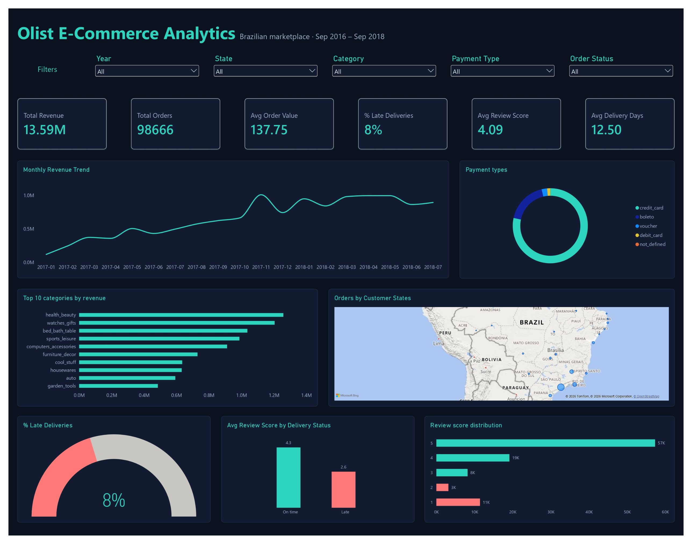

# Olist E-Commerce Analytics: SQL + Power BI

An end-to-end analytics project on the Brazilian Olist marketplace dataset. I loaded the raw CSVs into MySQL, validated and cleaned the data with SQL, answered business questions with queries, and built an interactive Power BI dashboard on top.



## Business questions

1. How much revenue does the marketplace make, and how is it trending?
2. Which product categories and states drive sales?
3. How do customers pay?
4. How fast is delivery, and how often is it late?
5. Do late deliveries hurt customer satisfaction?

## Key findings

| Metric | Result |
|---|---|
| Total revenue | R$ 13.59 million (13,591,643.70) |
| Orders with items | 98,666 |
| Average order value | R$ 137.75 |
| Average delivery time | 12.5 days |
| Late deliveries | about 8% of delivered orders |
| Average review score | 4.09 out of 5 (99,223 reviews) |
| Review score, on-time orders | 4.3 |
| Review score, late orders | 2.6 |

- **Late delivery is the biggest driver of bad reviews.** Orders that arrive after the promised date average roughly 1.7 stars less than on-time orders (2.6 vs 4.3). Only about 8% of orders are late, so fixing delivery is a targeted, high-impact lever.
- **Revenue grew strongly through 2017** and then levelled off at roughly R$ 0.85–1.0M per month through 2018, with a visible spike in November 2017.
- **Top categories by revenue:** health_beauty, watches_gifts and bed_bath_table.
- **Credit card is the dominant payment method**, followed by boleto (a Brazilian bank-slip payment).
- **Sales are concentrated in the south-east**, with the largest customer base around São Paulo.

> Revenue is the sum of item `price` (shipping excluded). Payment totals are higher than revenue because they include freight.

## Tools

- **MySQL** and MySQL Workbench: data loading, validation, cleaning, analysis
- **Power BI Desktop**: data model, DAX measures, dashboard
- **Dataset:** [Brazilian E-Commerce Public Dataset by Olist](https://www.kaggle.com/datasets/olistbr/brazilian-ecommerce) (Kaggle), about 100,000 orders from Sep 2016 to Oct 2018. The raw data is not included in this repository.

## Data model

Eight tables, linked as a star around `orders` and `order_items`.

```
customers --< orders >-- order_items >-- products >-- category_translation
                |             |
                |             +-- sellers
                +-- order_payments
                +-- order_reviews
```

| Table | Rows | Primary key |
|---|---|---|
| customers | 99,441 | customer_id |
| orders | 99,441 | order_id |
| order_items | 112,650 | order_id + order_item_id |
| order_payments | 103,886 | order_id + payment_sequential |
| order_reviews | 99,223 | review_id + order_id |
| products | 32,951 | product_id |
| sellers | 3,095 | seller_id |
| category_translation | 71 | product_category_name |

## Process

### 1. Setup (`01_create_and_load.sql`)
Created the `olist_ecommerce` database, created staging tables without constraints, and loaded the CSVs with `LOAD DATA LOCAL INFILE`. Empty date and numeric fields were converted to `NULL` using `NULLIF`. Row counts matched the source files except `order_reviews`, which loaded 99,223 of 99,224 rows; the one-row gap does not change the results.

### 2. Data understanding and validation (`02_cleaning_and_validation.sql`)
- Checked every table for duplicate keys. Only `order_reviews` repeats a `review_id`; the repeats belong to different orders, so the key is `review_id + order_id`.
- Added primary keys to all 8 tables after the checks passed.
- Checked every column for missing values.
- Checked referential integrity: no orphan rows between items, payments, reviews, orders, customers, products and sellers.

### 3. Data quality findings

| Check | Result | Action |
|---|---|---|
| Products with no category | about 610 | Labelled `unknown` |
| Delivered orders with no delivery date | 8 | Kept; excluded from delivery-time metrics |
| Non-delivered orders with a delivery date | 6 | Kept |
| Delivery date earlier than purchase date | 0 | None needed |
| Orphan rows across all links | 0 | None needed |
| Duplicate `review_id` values | 789 (different orders) | Composite key |

### 4. Analysis (`03_analysis.sql`)
Nine SQL queries answer the five business questions above. Examples:

**Monthly revenue**
```sql
select date_format(o.order_purchase_timestamp, '%Y-%m') as month,
count(distinct o.order_id) as orders, round(sum(i.price), 2) as revenue
from orders o join order_items i
on o.order_id = i.order_id
group by month order by month;
```

**Top categories by revenue**
```sql
select p.product_category_name as category, round(sum(i.price), 2) as revenue
from order_items i join products p on i.product_id = p.product_id
group by p.product_category_name order by revenue desc limit 10;
```

**Review score: late vs on-time orders**
```sql
-- late orders
select avg(r.review_score) as avg_score_late
from orders o join order_reviews r
on o.order_id = r.order_id
where o.order_delivered_customer_date > o.order_estimated_delivery_date;

-- on-time orders
select avg(r.review_score) as avg_score_on_time
from orders o join order_reviews r
on o.order_id = r.order_id
where o.order_delivered_customer_date <= o.order_estimated_delivery_date;
```

### 5. Dashboard
Built in Power BI with a navy and teal theme, five slicers (year, state, category, payment type, order status), six KPI cards and seven visuals.

DAX measures used:

```
Total Revenue = SUM(orderitems[price])
Total Orders = DISTINCTCOUNT(orderitems[order_id])
Avg Order Value = DIVIDE([Total Revenue], [Total Orders])
Avg Delivery Days = AVERAGE(orders[Delivery Days])
% Late Deliveries = AVERAGE(orders[Is Late])
Avg Review Score = AVERAGE(orderreview[review_score])
```

## Recommendations

1. **Improve delivery reliability first.** Late orders cost about 1.7 review stars. Tighter delivery estimates or carrier targets on the late 8% would raise satisfaction.
2. **Invest in the top categories** (health_beauty, watches_gifts, bed_bath_table), which account for the largest share of revenue.
3. **Support the main payment methods.** Credit card and boleto cover most payments, so checkout friction there matters most.
4. **Look at regional logistics.** Sales are concentrated in the south-east; delivery performance in distant states is worth reviewing.

## Limitations

- The usable revenue period is January 2017 to August 2018. Late 2016 and September–October 2018 contain only a handful of orders, so trend charts start in 2017.
- Revenue excludes freight, and currency is Brazilian reais (R$).

## Repository structure

```
olist-sql-powerbi/
├── README.md
├── dashboard.jpg
├── 01_create_and_load.sql
├── 02_cleaning_and_validation.sql
└── 03_analysis.sql
```

## Author

Komal Joshi, Data Analyst, Hyderabad. Skills: SQL, Power BI, Excel, Python, Tableau, R.
[LinkedIn](https://www.linkedin.com/in/komal-joshi-359139337/) · [Portfolio](https://komal-joshi.netlify.app/) · komaljoshi0728@gmail.com
